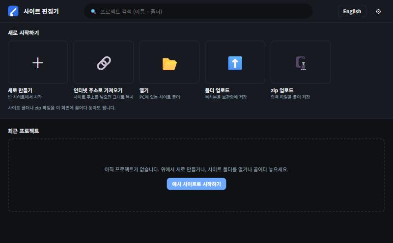
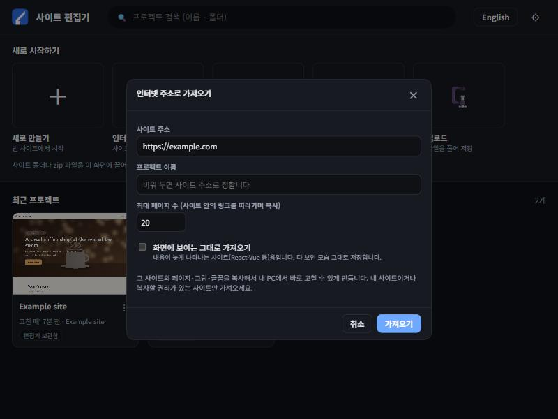
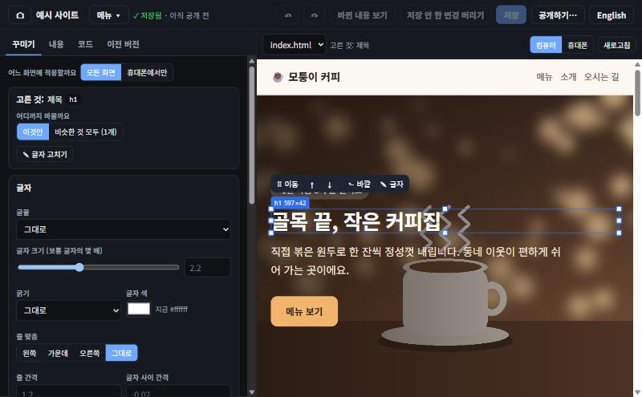
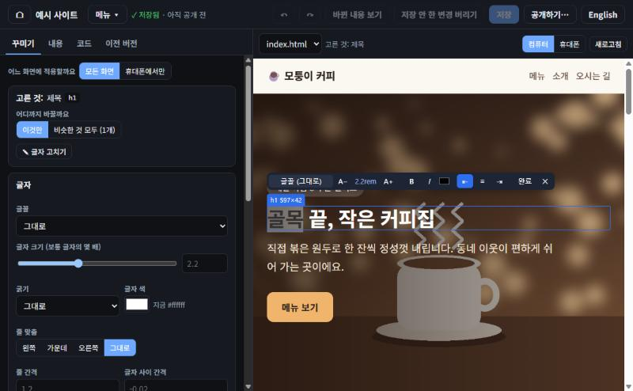

# 사이트 편집기

이미 있는 웹사이트를 **클릭해서** 고치고, 바뀐 내용을 확인한 뒤 내 서버에 올리는 프로그램입니다. HTML을 몰라도 됩니다.

> English: [README.md](README.md)



## 1. 설치 (한 번만)

- Windows에서는 **`install.cmd`를 더블클릭**합니다.
  - 바탕화면과 시작 메뉴에 「사이트 편집기」 바로가기가 생깁니다.
  - 다음부터는 바로가기 한 번이면 열립니다. 이미 열려 있으면 그 창을 앞으로 가져옵니다.
- 다른 OS에서는 `python launcher.py`를 실행합니다.
- 필요한 것은 Python 3.10 이상뿐입니다.
- 화면 언어는 오른쪽 위 **English / 한국어** 버튼으로 바꿉니다.

## 2. 처음 화면

| 버튼 | 하는 일 |
|---|---|
| **새로 만들기** | **예시 사이트(카페)** 또는 빈 사이트로 시작합니다 |
| **인터넷 주소로 가져오기** | 지금 인터넷에 있는 사이트 주소를 넣으면 그 사이트를 복사해 와서 바로 고칠 수 있게 합니다 |
| **열기** | 내 PC의 사이트 폴더를 그 자리에서 고칩니다(복사하지 않음) |
| **폴더 업로드 · zip 업로드** | 복사본을 편집기 보관함에 넣습니다. 화면에 끌어다 놓아도 됩니다 |
| 카드의 **⋮** | 이름 바꾸기, 사본 만들기, 폴더 열어 보기, zip으로 내려받기, 목록에서 빼기, 삭제(휴지통으로) |



## 3. 꾸미기 (클릭해서 고치기)



- **고르기:** 바꾸고 싶은 곳을 클릭하면 파란 테두리가 생깁니다.
  - 왼쪽에 "고른 것: 제목"처럼 이름이 나옵니다.
  - "이것만 / 비슷한 것 모두"에서 바꿀 범위를 고릅니다.
- **크기:** 테두리의 네모 손잡이를 끕니다. 절반·전체 같은 자리에 자석처럼 붙고, Alt를 누르면 안 붙습니다.
- **순서:** 위에 뜬 막대의 **⠿ 이동**을 끌거나 상자를 끕니다. 분홍 선이 들어갈 자리입니다.
- **정확한 값:** 왼쪽 칸에서 글꼴, 글자 크기(보통 글자의 몇 배), 굵기, 색, 줄 맞춤, 간격, 너비, 배경색, 모서리, 그림자를 숫자로 맞춥니다.
- **휴대폰만:** "휴대폰에서만"을 고르면 휴대폰 화면에만 적용됩니다.



- **글자:** 두 번 클릭하면 그 자리에서 입력합니다.
  - 떠 있는 막대로 글꼴·크기·굵게·기울임·색·줄 맞춤을 바꿉니다.
  - **일부 글자만 드래그해 고르면** 그 글자만 바뀝니다.
  - **완료**(Ctrl+Enter)로 끝내고, Esc로 취소합니다.

## 4. 저장과 되돌리기

- **자동 저장:** 고치면 저절로 저장되고 위에 **✓ 저장됨**이 보입니다. 아직 인터넷에 올라간 것은 아닙니다.
- **되돌리기:** **↶ / ↷**(Ctrl+Z / Ctrl+Y)는 저장한 뒤에도 됩니다. 더 예전 모습은 **이전 버전** 탭에서 되돌립니다.
- **바뀐 내용 보기:** 코드가 어떻게 바뀌는지 초록(더해짐)·빨강(빠짐)으로 보여 줍니다.
- **원래 구조 보존:**
  - 꾸민 내용은 `site-editor.css` 한 파일에만 모이고, 원래 디자인 파일은 그대로 둡니다.
  - 글자·순서는 HTML의 그 부분만 바뀝니다.

## 5. 공개하기 (인터넷에 올리기)

1. **공개하기…**를 누르고 **공개할 곳**을 고릅니다.
   - GitHub Pages, SFTP, FTP/FTPS, 폴더 중에서 고를 수 있습니다.
   - 처음이면 **+ 공개할 곳 추가**에서 서버 정보를 넣고 **연결 확인**을 눌러 봅니다.
2. 바뀐 파일과 내용을 확인합니다. 비밀번호·열쇠 같은 내용이 보이면 올리지 않습니다.
3. **"위 내용을 인터넷에 올려도 됩니다"**에 체크하고 **공개하기**를 누릅니다.
4. 올리기 전에 서버의 원래 파일을 백업하고, 다 올린 뒤 인터넷의 사이트가 바뀌었는지 확인합니다.
5. 잘못 올렸으면 **지난번 공개 되돌리기**를 누릅니다.

비밀번호는 Windows 자격 증명 관리자에만 보관되고, 화면·로그·프로젝트 파일에는 남지 않습니다.

## 6. 안전 메모

- **접속 범위:** 이 PC(`127.0.0.1`)에서만 열리고, 실행할 때마다 새로 만드는 열쇠가 있어야 접속됩니다.
- **가져오기:** 내 사이트이거나 복사할 권리가 있는 사이트만 가져오세요.
- **업로드한 사이트:** 그 사이트의 스크립트는 편집 화면 안에서 실행되니, 믿을 수 있는 사이트만 여세요.

## 7. 테스트

```bash
python -m unittest discover -s tests -v
```

테스트 67개가 네트워크 없이 돌아갑니다. 화면 문구가 하나라도 번역되지 않으면 실패하는 시험도 들어 있습니다.
