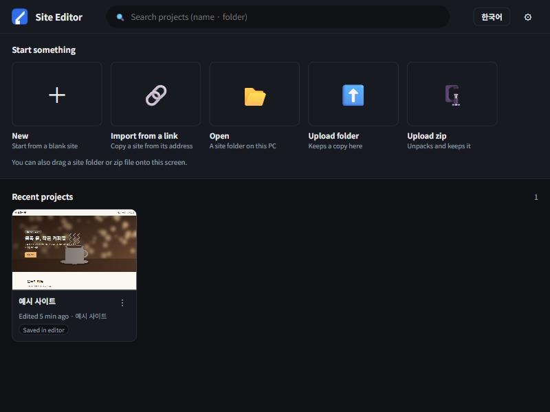
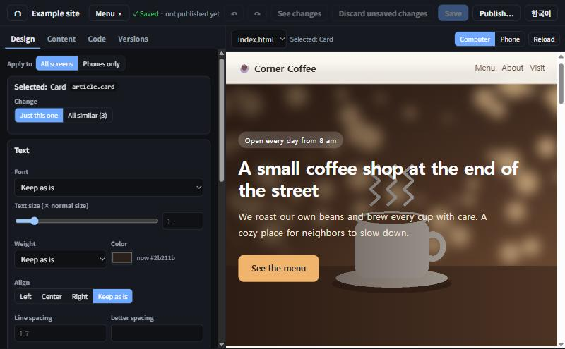
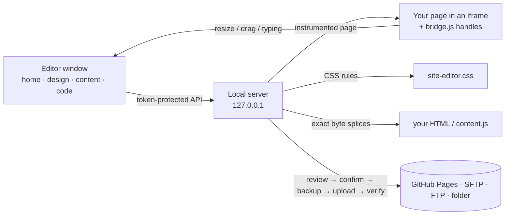

# Site Editor

Edit an existing website **by clicking on it**, then publish it to your own server after checking exactly what changed. No HTML knowledge needed.

[](https://github.com/son2240/site-editor/actions/workflows/test.yml)


> 한국어 설명서: [README.ko.md](README.ko.md)





## What it does

| | |
|---|---|
| **Home screen** | Your projects as cards with real screenshots, like a document list. Start from the **example site**, a blank site, a folder on your PC, an uploaded folder/zip, or **any live website by its address** |
| **Click to edit** | Click a part of the page. Drag the handles to resize; it snaps to half, full and other handy sizes. Drag a block to reorder it. Double-click text to type in place, with a floating bar for font, size, bold, color and alignment. You can also style just a few selected words |
| **Plain words** | The interface is in English or Korean with everyday wording: "Publish", "See changes", "Just this one / All similar". Sizes are shown as "× normal text size", not CSS units |
| **Safe changes** | Autosave, undo/redo that works across saves, and a version history. Design changes become CSS rules in one file (`site-editor.css`), so your own CSS is never rewritten. Text and order changes touch only those bytes of the HTML |
| **Publish anywhere** | GitHub Pages (git push), SFTP, FTP/FTPS or a folder. Before anything goes online: a file list and diff, a secret scan, and an explicit "Yes, put this online". The server copy is backed up first, the live URL is checked byte for byte afterwards, and one-step undo is available |
| **Your data stays yours** | Runs only on `127.0.0.1` with a random session token. Server passwords go to the OS credential store (Windows Credential Manager, macOS Keychain) and are never shown or written to the project |

## Quick start

```bash
git clone https://github.com/son2240/site-editor.git
cd site-editor
python launcher.py          # opens the editor window (Edge/Chrome app window)
```

On Windows, double-click **`install.cmd`** once. It adds desktop and Start menu shortcuts, and after that one double-click opens the editor (or brings the open window to the front). No console window appears.

Then click **New → Example site** and try it:
1. Click the big title, then drag the right handle to make it narrower.
2. Double-click the title and type. Select a word and press **A+**.
3. Drag a menu card in front of another one.
4. Use **↶** to undo, and **See changes** to see the code difference.
5. To put it online, click **Publish…** and add a place to publish (for example a GitHub Pages repository or an SFTP server).

Requirements: Python 3.10+, standard library only. `keyring` is optional (used for passwords when present). Edge or Chrome is used for thumbnails and for importing sites whose content is drawn by JavaScript.

## How it works



| Module | Role |
|---|---|
| `editor.py` | The local app server: home, projects, design preview, autosave, publish jobs |
| `htmlmap.py` | Maps every element to exact byte ranges, so edits never reformat your HTML |
| `static/bridge.js` | Selection, resize handles with snapping and guides, drag-to-reorder, in-place text editing (in a shadow DOM, so it never leaks into the site) |
| `styles.py` | Design changes as validated CSS rules, with responsive warnings |
| `importer.py`, `cdp.py` | Import a live site: crawl the same host, download assets, rewrite links to relative paths. An optional headless-browser mode handles JavaScript-drawn pages |
| `targets.py`, `deploy.py` | Publish targets, review/diff, secret scan, server backup, rollback, live check |
| `projects.py`, `thumbs.py`, `launcher.py` | Project list, uploads, example sites, screenshots, shortcuts, single instance |
| `static/i18n.js` | English/Korean interface with plain wording (a test fails if any text is untranslated) |

## Tests

```bash
python -m unittest discover -s tests -v
```

The 67 tests run offline, against fake sites, fake FTP and a local bare git remote. They cover HTML byte preservation, CSS validation, undo across saves, imports (link rewriting, zip-slip, page limits), publish targets (backup, rollback, secret blocking), the token/cookie/host guard, launcher behavior and translation coverage. The "copy exactly what the screen shows" import test also uses Edge or Chrome when one is installed.

## License

MIT. The example sites (`examples/`) use made-up content and pictures drawn for this project.
